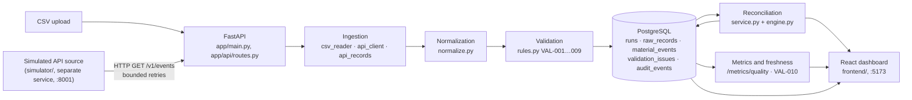

# Architecture

RecyTrack is a FastAPI backend, a PostgreSQL database, a React dashboard and a separate simulated API source.
Each processing step is its own module (NFR-01), so a rule or a source can change without touching the others.
All data is synthetic.

The dashboard talks to the API only, through same-origin `/api/v1/...` calls (Vite proxies them in development,
nginx in Docker), so the API needs no CORS settings.

## Layers

### API (`backend/app/main.py`, `backend/app/api/routes.py`)

FastAPI with Pydantic schemas (`app/schemas.py`). The middleware reads or creates `X-Request-ID`, returns it, and
writes one structured log line per request. Database errors become actionable `503`/`500` answers without SQL or
connection strings (FR-19). Uploads are limited by type and size (NFR-05). Interactive docs are at `/docs`.

### Ingestion (`backend/app/ingestion/`, `backend/app/pipeline.py`)

`csv_reader.py` checks the header against the contract and turns each row into an immutable `RawRecord` with a
SHA-256 hash of its payload. `api_client.py` reads the simulated source with `httpx`: only connection errors,
timeouts and 5xx are retried, at most `SOURCE_RETRY_ATTEMPTS` times with exponential backoff; a 4xx fails at once.
`api_records.py` maps the source's field names to the contract and keeps the original item as `_source_json`.
`pipeline.py` gives every source the same run record and the same processing loop (`process_raw_records`). The raw
record is stored **before** anything else happens, so nothing is silently dropped (FR-03). A source that cannot be
read is saved as a `FAILED` run with an actionable `error_summary`.

### Normalization (`backend/app/normalization/normalize.py`)

Whitespace cleanup, material aliases to material codes, `lb` to `kg` with an exact `Decimal` constant, and every
timestamp converted to UTC. A value that cannot be normalized becomes `None`; the raw value stays in the raw record.

### Validation (`backend/app/validation/`)

`rules.py` implements VAL-001…VAL-008 and maps the issues to a status: any `ERROR` → `QUARANTINED`, only
`WARNING`s → `FLAGGED`, none → `ACCEPTED`. The pipeline adds VAL-007 (exact duplicate, no new event) and VAL-009
(same key, different values, both kept). `freshness.py` is VAL-010, computed from the runs table when asked.
Details: [validation_rules.md](validation_rules.md).

### Persistence (`backend/app/database/`)

SQLAlchemy 2 over PostgreSQL 16 (SQLite for local use and most tests). `raw_records` and `audit_events` are only
inserted, never updated. A unique constraint on `(source_name, source_record_id, payload_hash)` backs up the
pipeline's duplicate check if two imports run at the same time. Review decisions are separate audit rows; source
values are never changed. The schema is created with `create_all` (no migrations yet).

### Reconciliation (`backend/app/reconciliation/`)

`engine.py` is pure: given the candidate events, it computes the material-flow balance in `Decimal`, the tolerance
`max(absolute, percent × throughput)` and the status (`WITHIN_TOLERANCE`, `NEEDS_REVIEW` or `NEEDS_DATA`).
`service.py` loads the events, saves a new snapshot with links to every event it used or left out, and writes an
audit row. Snapshots are never updated; running again creates a new one.

### Metrics

`GET /api/v1/metrics/quality` counts and rates per run or time window, open exceptions, issues per rule, and the
number of stale sources. `scripts/measure.py` measures the pipeline itself on the labeled fixtures; see
[results.md](results.md).

### Dashboard (`frontend/`)

React 19 + TypeScript + Vite. Pages: Overview, Ingestion, Records, Exceptions and detail, Reconciliation and detail,
Source health. Quantities stay decimal strings end to end and are formatted on their digits, never via floats.
Times are shown in UTC. Filters live in the URL. See [frontend/README.md](../frontend/README.md).

### Simulated source (`backend/simulator/`)

A separate FastAPI app with 200 deterministic synthetic events (10% deliberately faulty), field names that differ
from the CSV contract, and fault injection (`SIM_FAILURE_MODE`). The API reaches it over real HTTP, like an
external system. Contract: [data_dictionary.md](data_dictionary.md#simulated-api-source-contract-m7).

## Deployment

`docker-compose.yml` runs `db` (PostgreSQL 16), `simulator`, `api` and `web` (nginx serving the built dashboard).
Health checks gate the start order: `api` waits for a healthy `db`, `web` for a healthy `api`. Configuration comes from
environment variables only; secrets stay in `.env`, which is not committed. See [operations.md](operations.md).
